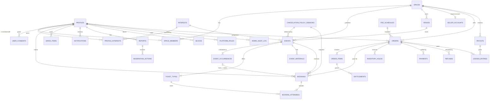

# Domain model

Status: **proposed** (M0). One Postgres schema in Supabase, one modular monolith. Visitor, organizer and admin views read the **same canonical rows**. There are no per-workspace copies.

Principles:
- **Space** is the single tenant boundary for anything an organizer publishes or sells. Solo creators, communities, studios and associations are all `spaces`, with `kind` and capability flags. They never get parallel tables.
- **Event → occurrences → bookings → attendees** is shared by one-off, multi-session, recurring, online and private events.
- **Commerce is separate from booking.** An order buys order items. Payments, refunds and ledger entries are their own records. Entitlements and bookings are *granted* by a verified order, never by a client redirect.
- **Money** is stored as integer cents plus a currency. Fees come from a versioned `fee_schedules` row that is **snapshotted on the order**. No percentage is hard-coded.
- **Policies** (cancellation, fees) are versioned and immutable, and bookings and orders reference the exact version they were bought under.
- Soft delete (`deleted_at`) on user-generated content. Hard delete or anonymisation runs through a GDPR job. Every admin mutation writes to `admin_audit_log`.

## Initial tables (M1–M3)

| Area | Table | Key columns / notes |
|---|---|---|
| Identity | `profiles` | `id = auth.users.id`, `handle`, `display_name`, `avatar_asset_id`, `bio`, `approx_city`, `approx_geo` (coarse, consented), `visibility` (`public`/`members`/`private`), `locale`, `status` (`active`/`suspended`/`deleted`) |
| | `user_consents` | `profile_id`, `kind` (`marketing_email`, `push`, `location`), `granted_at`, `revoked_at`, `source`, append-only |
| | `interests` | admin-managed categories: `slug`, `label_sl`, `parent_id`, `is_active` |
| | `profile_interests` | `profile_id`, `interest_id` |
| Spaces | `spaces` | `kind` (`solo_creator`/`community`/`studio`/`association`), `slug`, `name`, `bio`, `city`, `social_links jsonb`, `membership_mode` (`none`/`open`/`approval`), `verification_status`, `capabilities jsonb` (feature flags per space), `created_by` |
| | `space_members` | `space_id`, `profile_id`, `role` (`owner`/`admin`/`staff`/`member`), `status` (`pending`/`active`/`removed`), `invited_by`. Partial unique index: one active `owner` per space |
| Events | `venues` | `space_id`, `name`, `address`, `geo`, `is_public` |
| | `events` | `space_id`, `created_by`, `schedule` (`one_off`/`multi_session`/`recurring`), `booking_scope` (`series`/`occurrence`), `is_online`, `visibility` (`public`/`unlisted`/`private`/`members_only`), `invite_token_hash`, `registration_mode` (`native`/`manual_payment`/`external`), `external_url`, `title`, `summary`, `description`, `interest_id`, `venue_id`, `online_url` (protected), `capacity`, `registration_opens_at/closes_at`, `cancellation_deadline_hours`, `cancellation_policy_version_id`, `status` (`draft`/`published`/`cancelled`/`archived`), `published_at` |
| | `event_occurrences` | `event_id`, `starts_at`, `ends_at` (timestamptz), `capacity_override`, `status` (`scheduled`/`cancelled`/`rescheduled`), `rescheduled_from_id` |
| | `ticket_types` | `event_id`, `name`, `price_cents`, `currency`, `capacity`, `sales_start/end`, `max_per_booking`, `sort`, `is_active` |
| | `event_materials` | `event_id`, `label`, `asset_id` (optional), visible to booked attendees |
| | `cancellation_policy_versions` | `code`, `version`, `title_sl`, `rules jsonb`, immutable |
| Bookings | `bookings` | `event_id`, `occurrence_id` (**NULL = whole series**), `booker_id`, `status` (`held`/`pending_payment`/`confirmed`/`waitlisted`/`cancelled_by_user`/`cancelled_by_organizer`/`expired`), `quantity`, `source` (`native`/`manual`/`organizer_added`), `order_id`, `policy_version_id`, `waitlist_position`, `hold_expires_at` |
| | `booking_attendees` | `booking_id`, `ticket_type_id`, `attendee_name`, `profile_id` (nullable for guests of a group booking), `checked_in_at` |
| | `saved_items` | `profile_id`, `target_type` (`event`/`idea`/`space`), `target_id` |
| Comms | `notifications` | `recipient_id`, `kind`, `payload jsonb`, `channel`, `read_at`, `sent_at` |
| | `notification_preferences` | `profile_id`, `kind`, `email`, `push` (service notices cannot be disabled; marketing defaults off) |
| | `conversations`, `conversation_participants`, `messages` | M3. `messages.body`, `sender_id`, `created_at`, `deleted_at` |
| Trust | `blocks` | `blocker_id`, `blocked_id` |
| | `reports` | `reporter_id`, `target_type`, `target_id`, `reason`, `details`, `status`, `risk_score` |
| | `moderation_actions` | `report_id`, `moderator_id`, `action`, `reason` |
| Platform | `platform_roles` | `profile_id`, `role` (`super_admin`/`admin`/`moderator`/`finance`/`support`) |
| | `admin_audit_log` | `actor_id`, `action`, `target_type`, `target_id`, `before jsonb`, `after jsonb`, `reason`, `created_at`. Append-only (no UPDATE/DELETE grants) |
| | `feature_flags` | `key`, `enabled`, `rules jsonb` |
| | `fee_schedules` | `scope` (`platform`/`space`), `space_id`, `percent_bps`, `fixed_cents`, `applies_to` (`ticket`/`digital`), `valid_from`, `valid_to` |
| | `posting_quotas` | `scope`, `period`, `max_events`, `max_ideas`, `valid_from` |
| Files | `assets` | `owner_id`, `space_id`, `bucket`, `path`, `mime`, `bytes`, `access` (`public`/`entitled`/`private`), `scan_status` |
| Commerce (M3) | `seller_accounts` | `space_id`, `provider`, `provider_account_id`, `status` (`not_started`/`pending`/`verified`/`restricted`) |
| | `orders` | `buyer_id`, `space_id`, `status` (`open`/`awaiting_payment`/`paid`/`failed`/`refunded`/`partially_refunded`/`disputed`), `currency`, `gross_cents`, `platform_fee_cents`, `processor_fee_cents`, `tax_cents`, `net_to_seller_cents`, `fee_schedule_id`, `idempotency_key` |
| | `order_items` | `order_id`, `item_type` (`ticket`/`idea`/`course`), `ticket_type_id`/`idea_id`/`course_id`, `quantity`, `unit_price_cents` |
| | `inventory_holds` | `ticket_type_id`, `occurrence_id`, `quantity`, `order_id`, `expires_at` (prevents overselling during checkout) |
| | `payments` | `order_id`, `provider_ref`, `status`, `amount_cents` |
| | `payment_events` | `provider_event_id` **UNIQUE** (idempotency), `type`, `payload`, `received_at`, `processed_at`, `error` |
| | `refunds` | `order_id`, `amount_cents`, `reason`, `status`, `provider_ref`, `initiated_by` |
| | `ledger_entries` | `account` (`buyer_cash`/`platform_fee`/`processor_fee`/`seller_payable`/`refunds`), `amount_cents` (signed), `order_id`/`refund_id`/`payout_id`. Sums to zero per transaction |
| | `payouts` | `space_id`, `amount_cents`, `provider_ref`, `status`, `period` |
| | `entitlements` | `profile_id`, `resource_type`, `resource_id`, `order_item_id`, `granted_at`, `revoked_at` |

## Later tables (M4+)

| Milestone | Tables |
|---|---|
| M4 ideas | `ideas` (author, optional space, `guide_type` photo/pdf/external, price, status), `idea_assets`, `comments` (polymorphic target, threaded), `reactions`, `reviews` (rating 1–5, one per buyer/user per idea), `showcase_photos` (user-made results) |
| M4 community | `community_posts`, `groups`, `group_members` (private groups inside a space) |
| M5 courses | `courses`, `course_modules`, `lessons`, `lesson_assets` (video via a signed-URL host), `lesson_progress` |
| M5 studio | `staff_assignments` (instructor ↔ occurrence), `pass_products`, `pass_holdings`, `pass_redemptions`, `attendance` (may reuse `booking_attendees.checked_in_at`) |
| M3/M6 support & growth | `support_tickets`, `promo_codes`, `promotions` (boosts), `editorial_picks`, `membership_plans` (paid dues, M6), shop `products`/`shipments` (future) |

## ER diagram (initial scope)

## Key invariants (to be enforced in SQL and tested)

1. `bookings.occurrence_id IS NULL` ⇔ `events.booking_scope = 'series'`.
2. Confirmed + held seats per occurrence (or per event for series) ≤ capacity. This is enforced in a `SECURITY DEFINER` function with row locks, not in client code.
3. A booking with `order_id` becomes `confirmed` **only** from the payment webhook handler after `payment_events` is recorded once.
4. `ledger_entries` sum to 0 per order/refund/payout.
5. `cancellation_policy_versions` and `fee_schedules` rows referenced by an order or booking can't be updated.
6. `events.registration_mode = 'external'` ⇒ no bookings and no ticket sales on Mekko.
7. Paid `ticket_types.price_cents > 0` with `registration_mode = 'native'` requires `seller_accounts.status = 'verified'` and the `payments_enabled` flag.
